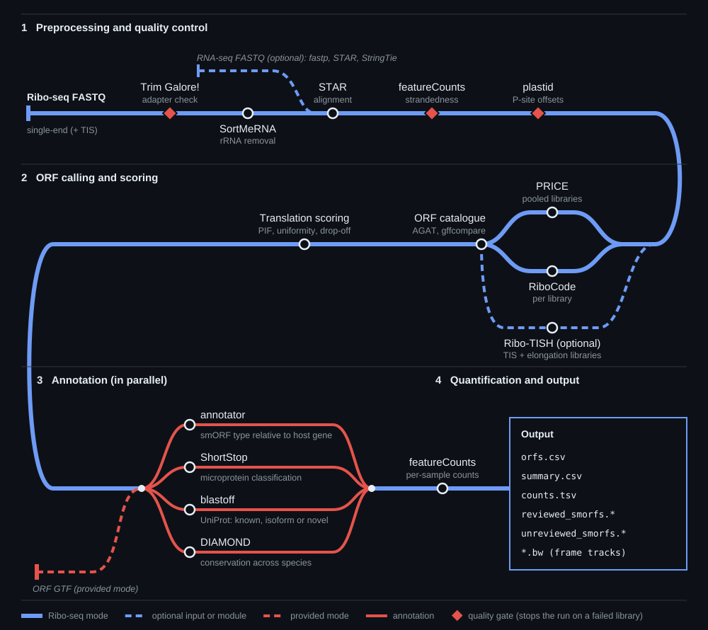

<p align="center">
  
</p>

<p align="center">
  <b>Small ORF discovery, scoring and annotation from ribosome profiling</b>
</p>

<p align="center">
  <a href="#quick-start">Quick start</a> ·
  <a href="#modules">Modules</a> ·
  <a href="docs/usage.md">Usage</a> ·
  <a href="docs/output.md">Output</a> ·
  <a href="docs/methods.md">Methods</a> ·
  <a href="docs/claude.md">Use with Claude</a>
</p>

<p align="center">
  <a href="https://snakemake.github.io"></a>
  <a href="LICENSE"></a>
</p>

---

smORF-Bullpen takes single-end Ribo-seq reads to a scored, annotated and quantified catalogue of
small open reading frames in one Snakemake run. ORFs are scored on the translation signatures
used for GENCODE smORFs v2 ([Chothani et al. 2026](https://doi.org/10.1093/nar/gkag234)), with
thresholds fitted to each dataset's own coding sequences, and every reported ORF must show
translation evidence of its own rather than borrowing reads from a known gene.

Already have a set of ORFs? **Provided mode** skips the Ribo-seq steps and runs the annotation
modules on any ORF GTF.



## Modules

Beyond preprocessing, every stage is a module that you switch on by listing it in the run
config. Only the listed modules are built, and only their columns appear in the results. The
template runs everything except assembly:

```yaml
tools:
  assembly:     []                                # [stringtie] to assemble novel transcripts
  callers:      [price, ribocode]
  annotators:   [annotator, shortstop, blastoff]
  conservation: [diamond]
  counters:     [featurecounts]
  visualizers:  [frame_tracks]
```

| Module | Tool | What it adds |
|---|---|---|
| Assembly | `stringtie` | **ORFs on transcripts the annotation lacks.** Novel transcripts are assembled from bulk RNA-seq of the same cells, filtered for expression across samples and passed to the ORF callers. |
| Callers | `price`, `ribocode` | **Two complementary callers in one catalogue.** PRICE runs on all libraries pooled and RiboCode on each library. Every distinct ORF structure is kept as its own row, credited to each caller that found it. |
| Annotators | `annotator` | **smORF type** relative to the host gene (uORF, uoORF, iORF, dORF, lncRNA, psORF and others), grouped into Upstream, Internal, Isoform, Downstream and Non-coding. |
| | `shortstop` | **Microprotein classification** as secreted, intracellular, or resembling random sequence (PRISM), with a probability. |
| | `blastoff` | **Known, isoform or novel.** Exact sequence matching against UniProt separates known proteins from N- or C-terminal extensions, truncations, alternative exons, homologs and novel proteins, and refines the smORF type accordingly. |
| Conservation | `diamond` | **Evidence across species** (human, rat, cow, chicken, zebrafish). A second search against orthologs of the host gene makes short ORFs testable, and ORFs too short to test are flagged rather than called non-conserved. |
| Counters | `featurecounts` | **Per-sample smORF counts** for differential analysis, measured only on sequence no canonical CDS reaches, with flanks fitted to each dataset. Lowly translated smORFs can be excluded on pooled RPKM. |
| Visualizers | `frame_tracks` | **Frame-resolved P-site tracks** as bigWig files, ready to load in the UCSC Genome Browser. |

New callers and annotators plug in as a single rule file; see
[Adding a tool](docs/usage.md#adding-a-tool).

## Built into every run

- **Quality gates.** A library with a missing adapter, the wrong strandedness or no usable P-site
  offsets stops the run instead of producing results from bad data.
- **Thresholds fitted to each dataset.** PIF, uniformity and drop-off cut-offs come from the
  run's own annotated coding sequences, never hardcoded.
- **Evidence of each ORF's own.** An ORF needs in-frame P-sites in sequence it does not share
  with a known CDS, and pseudogene ORFs need support from uniquely mapped reads.
- **Results ready for downstream use.** One ORF table, plus GTF, nucleotide and protein FASTA
  files for reviewed and unreviewed smORFs.

## Quick start

smORF-Bullpen needs conda (or mamba) and Apptainer (or Singularity). It was built and tested on
mouse (GRCm39, Ensembl 110).

**1. Install** the pipeline and build the references:

```bash
git clone https://github.com/brendan-miller-salk/smORF-Bullpen.git
mamba env create -n bullpen-snakemake -f smORF-Bullpen/workflow/envs/snakemake.yaml
bash smORF-Bullpen/refs/fetch_references.sh /path/to/refs
```

**2. Set up a run directory** outside the repository, with a tab-separated samplesheet of
single-end libraries:

```tsv
sample	fastq
brain_rep1	/data/riboseq/brain_rep1.fastq.gz
brain_rep2	/data/riboseq/brain_rep2.fastq.gz
```

Save it as `config/samples.tsv`, then copy
[`config/config.template.yaml`](config/config.template.yaml) to `config/bullpen.yaml` and fill in
the reference paths, output directory and modules.

**3. Launch** on a Slurm cluster from the run directory:

```bash
mamba activate bullpen-snakemake          # the head job inherits this environment
export BULLPEN_REPO=/path/to/smORF-Bullpen
sbatch -A <account> -p <partition> $BULLPEN_REPO/profiles/slurm/run_head.sbatch config/bullpen.yaml
```

A single head job runs Snakemake and submits each step as its own Slurm job. Apptainer must be on
`PATH` as well (on many clusters, `module load apptainer`). Add `-n` at the end for a dry run.
Tool images and environments are built on the first run, which needs internet access. To run
without a scheduler, or to save your cluster's settings as a profile, see the
[usage guide](docs/usage.md).

**Prefer to work through Claude?** The included Claude Code plugin walks you through setup,
diagnoses failed runs and answers questions about your results:

```
/plugin install smorf-bullpen --marketplace brendan-miller-salk/smORF-Bullpen
```

See [Using smORF-Bullpen with Claude](docs/claude.md).

## What you get

The files to open first are written to the top of the output directory:

| File | Contents |
|---|---|
| `orfs.csv` | One row per ORF: coordinates, protein sequence, scores, annotations, counts and set membership |
| `summary.csv` | smORF counts per set and per smORF type |
| `README.md` | A description of the run and of every output column |
| `counts.tsv` | Read counts per sample for canonical genes and unreviewed smORFs |
| `reviewed_smorfs.{gtf,nuc,pep}` | smORFs whose protein is an exact Swiss-Prot sequence |
| `unreviewed_smorfs.{gtf,nuc,pep}` | All other smORFs |

## Documentation

| Guide | Covers |
|---|---|
| [Usage](docs/usage.md) | Installation, references, both modes, choosing modules, novel transcripts, cluster profiles, resources |
| [Output](docs/output.md) | Every output file and column, ORF sets and filters, QC reports |
| [Methods](docs/methods.md) | Scoring, evidence filters and how each module works |
| [Using with Claude](docs/claude.md) | Installing the Claude Code plugin to set up runs, diagnose failures and query results |
| [Contributing](docs/CONTRIBUTING.md) | Setting up a development machine, committing and keeping machines in sync |
| [Citations](CITATIONS.md) | References for every tool the pipeline runs |

## Citing smORF-Bullpen

If smORF-Bullpen contributes to your research, please cite this repository and the scoring
method: Chothani S, Ruiz-Orera J, Tierney JAS, _et al._ An expanded reference catalog of
translated open reading frames for biomedical research. _Nucleic Acids Res._ 2026;54(6):gkag234.
[doi:10.1093/nar/gkag234](https://doi.org/10.1093/nar/gkag234). Please also cite the tools used
in your run, listed in [CITATIONS.md](CITATIONS.md).

## License

Released under the [MIT License](LICENSE). Written by
[Brendan Miller](https://github.com/brendan-miller-salk) in Alan Saghatelian's lab at the Salk
Institute for Biological Studies. Bug reports and
feature requests are welcome on the
[issue tracker](https://github.com/brendan-miller-salk/smORF-Bullpen/issues).
